<p align="center">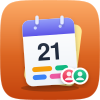</p>
<h1 align="center">Pocket Calendar</h1>
<p align="center">A self-hosted calendar for a household: shared calendars, invitations, reminders from the server, a CalDAV server for every phone, your iCloud, Google and Nextcloud calendars in one place, and the tasks, trips and bills from the other Pocket apps on the same grid.<br>One Go binary, one SQLite file, one volume.</p>
<p align="center">
  <a href="https://github.com/abjelosevic88/pocket-homelab-calendar/actions"></a>
  <a href="https://github.com/abjelosevic88/pocket-homelab-calendar/pkgs/container/pocket-homelab-calendar"></a>
  <a href="LICENSE"></a>
</p>

---

Pocket Calendar is built for the people who live together: everyone has their own calendars, shares the ones
they want — busy blocks only, read, edit or manage — invites each other to events and answers with
*Yes / Maybe / No*, and sees who is free before picking a time. Under the hood every event is an iCalendar
object in a CalDAV collection, so Apple Calendar, Fantastical, BusyCal, Thunderbird and DAVx5 sync it as-is,
and calendars from iCloud, Google, Nextcloud, Fastmail or any CalDAV server (and any `.ics` feed) are pulled
in and kept in sync both ways.

<p align="center">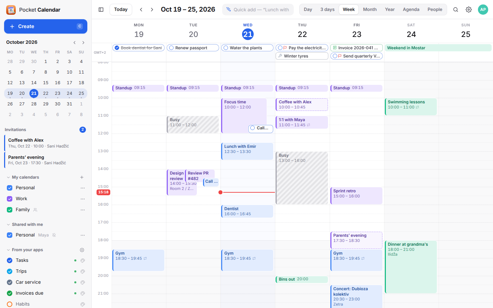</p>

<table>
  <tr>
    <td width="50%">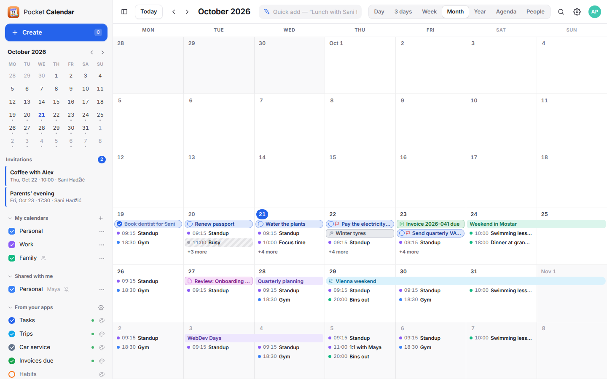</td>
    <td width="50%">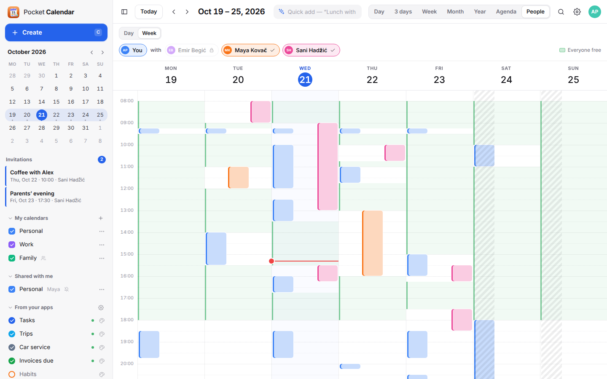</td>
  </tr>
  <tr>
    <td align="center"><sub>Month: trips span the days, tasks and bills on their day.</sub></td>
    <td align="center"><sub>People: everyone's busy time side by side, free stretches marked.</sub></td>
  </tr>
  <tr>
    <td width="50%">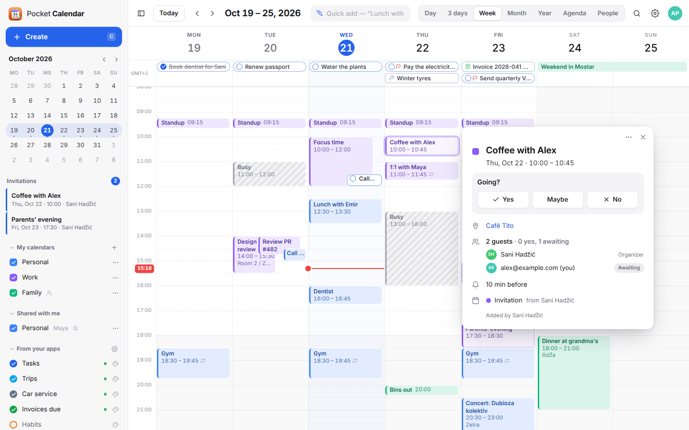</td>
    <td width="50%">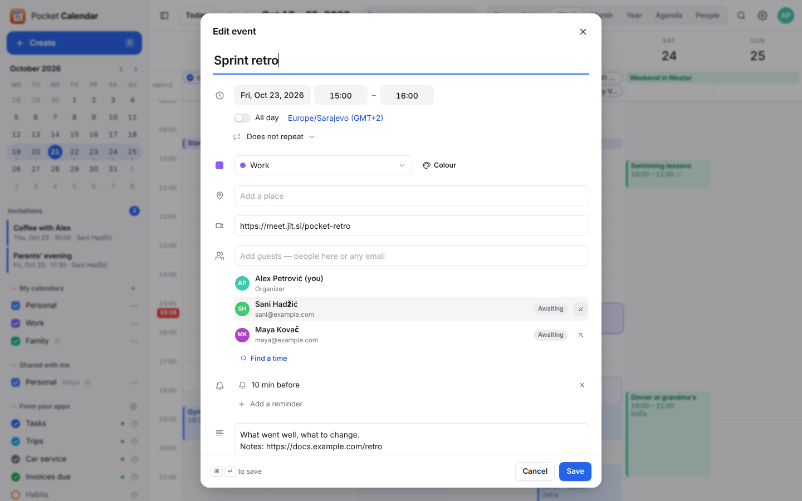</td>
  </tr>
  <tr>
    <td align="center"><sub>Invitations between people on the box, answered in one tap.</sub></td>
    <td align="center"><sub>Repeat rules, time zones, reminders and guests.</sub></td>
  </tr>
  <tr>
    <td width="50%">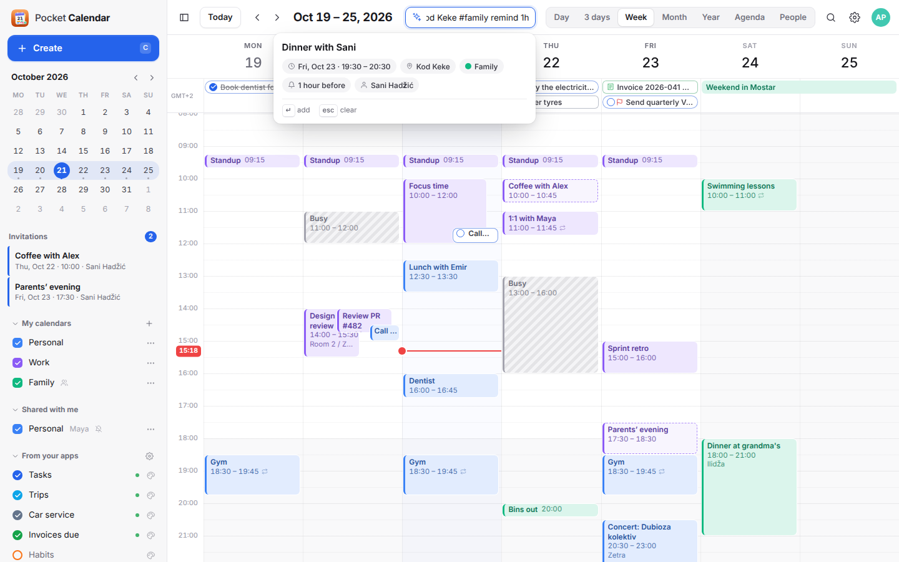</td>
    <td width="50%">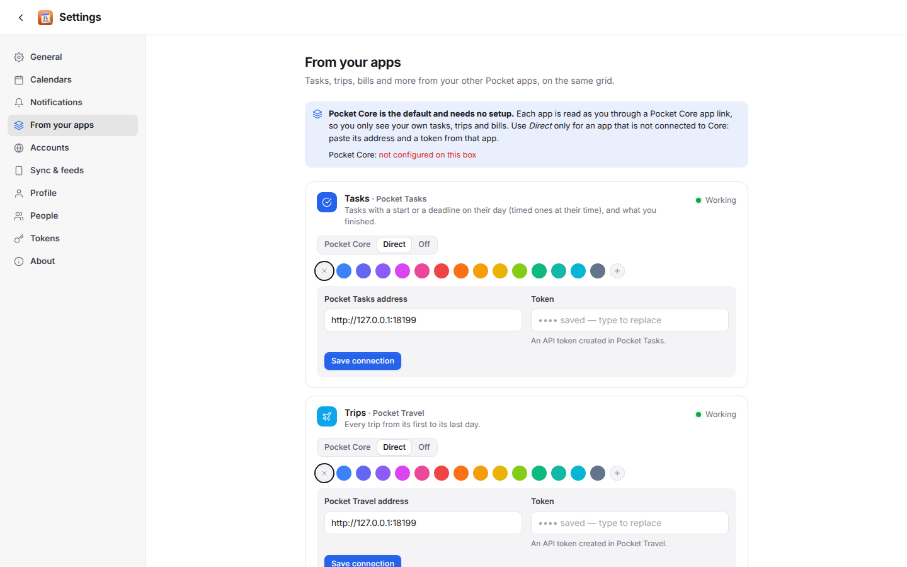</td>
  </tr>
  <tr>
    <td align="center"><sub>Quick add in plain words, previewed as you type.</sub></td>
    <td align="center"><sub>Tasks, trips, service and invoices from the other Pocket apps.</sub></td>
  </tr>
</table>

<p align="center">
  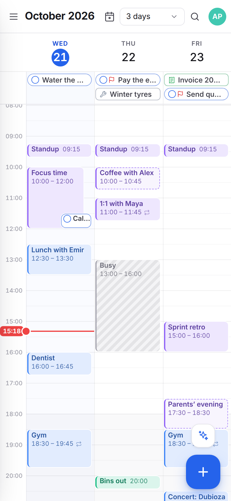&nbsp;&nbsp;
  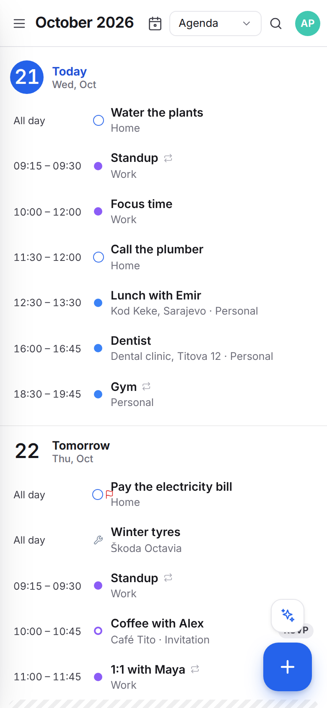&nbsp;&nbsp;
  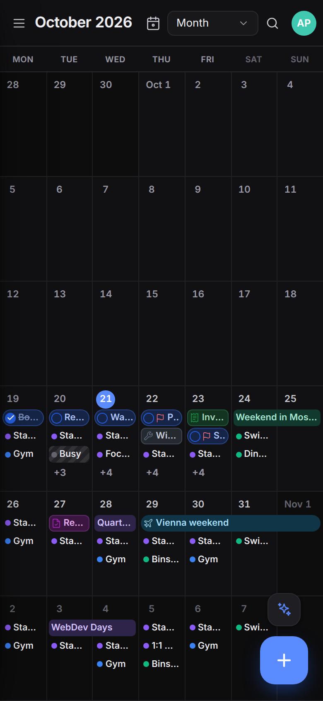
</p>

All screenshots use the built-in demo data. [How to refresh them](docs/screenshots/README.md).

## What it does

**A full calendar**
- Day, 3-day, week, month, year, agenda and a *people* view to find a time when everyone is free.
- Drag to create, drag to move, drag the edge to resize; *this / this and following / all* for recurring
  events; undo for moves and deletes; Recently deleted for 30 days.
- Recurring events with the whole of RRULE (every weekday, the second Tuesday, every 2 weeks until…),
  exceptions and moved occurrences, time zones per event and DST done right.
- Quick add in plain words: `Dinner with Sani fri 19:30-21 at Kod Keke #family remind 1h`.
- Reminders pushed from the server (Apprise, ntfy or a webhook), a morning agenda, video-call links found
  in invitations, search across titles, places, notes and attendees, keyboard shortcuts, dark mode, a PWA
  that works on a phone.

**Together**
- Calendars shared with a person, an email (bound when they first sign in) or everyone on the box, with
  four roles: *free/busy*, *read*, *write*, *manage*. Private events stay "Busy" for readers.
- Invitations between the people on the box with RSVP, and the answer goes back to the organizer.
- Each person can show their free/busy to the household (off by default) for the people view.
- Strictly per person: nobody — admins included — sees a calendar that was not shared with them.

**Every calendar you have**
- A CalDAV server at `/dav/` (and the Nextcloud-shaped `/remote.php/dav/`) for iPhone, Mac, Android (DAVx5)
  and Thunderbird; shared calendars show up there too. [Setup](docs/caldav.md).
- Accounts: iCloud, Google (OAuth), Nextcloud (with your account from Pocket Core, no password typed in),
  Fastmail and any CalDAV server, two-way; any `.ics` / `webcal://` subscription, read-only.
- A secret feed per calendar and one with everything a person sees, for apps that only subscribe.

**With the other Pocket apps** (through [Pocket Core](https://github.com/abjelosevic88/pocket-homelab-core) app
links, read live as the person — [details and what's next](docs/integrations.md))
- Pocket Tasks: dated tasks on their day or at their time — tick them off and drag them to reschedule.
- Pocket Travel trips, Pocket Garage service reminders, Pocket Invoicing due dates, Pocket Habits and Pocket
  Collaborator deadlines; public holidays.
- Pocket Contacts: birthdays and anniversaries on their day, and guests suggested from your contacts as you
  type in the event editor.
- Offers `calendar:read` and `calendar:write` so Day, Hub, Travel and the rest can read and add events, and
  publishes `calendar.*` events on the bus.

## Run it

```sh
docker run -d --name pocket-calendar -p 8080:8080 -v ./data:/data \
  -e BASE_URL=https://calendar.example.com -e TZ=Europe/Berlin \
  ghcr.io/abjelosevic88/pocket-homelab-calendar:latest
```

Open it and create the first account (or set `ADMIN_EMAIL` / `ADMIN_PASSWORD`). See
[docker-compose.yml](docker-compose.yml), [configuration](docs/configuration.md), the [API](docs/api.md) and
[CalDAV](docs/caldav.md). Put it behind HTTPS and set `SECURE_COOKIES=true`.

On a Pocket Box, set `CORE_URL` and `CORE_REGISTRATION_KEY`: the app registers itself, people sign in with
Pocket Core, and the other Pocket apps appear under *From your apps* with nothing to configure.

## Build

```sh
make web build      # React UI into web/dist, then the Go binary that embeds it
make run            # demo data, no login, on :8080
make test           # Go tests + type-check the UI
```

Go 1.26, Node 22. Stack: Go (chi, modernc SQLite, rrule-go), React 19 + Vite, no other runtime dependencies.

## License

MIT
